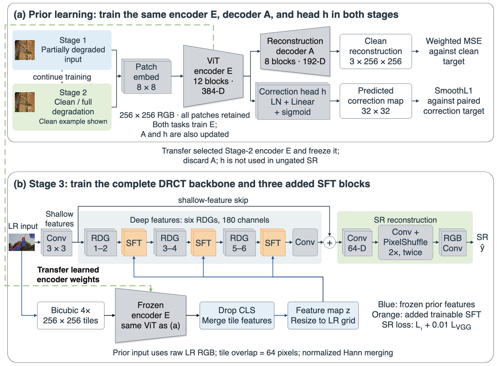

# CorrPrior

**Correction-Supervised Spatial Prior for Real-World Image Super-Resolution**

Le Hoai Nam and Nguyen Hoang Ha · University of Science and Technology of Hanoi

[](https://github.com/namle24/CorrPrior/actions/workflows/tests.yml)

[Method](docs/method.md) · [Training](docs/reproduction.md) ·
[Evaluation](docs/evaluation.md) · [Results](docs/results.md) · [Documentation](docs/README.md)

CorrPrior learns spatial features from paired degraded and clean images through
image reconstruction and patch-level correction prediction. After two stages
of prior learning, the encoder is frozen and guides a DRCT super-resolution
network through three residual Spatial Feature Transform (SFT) blocks.



The full DRCT backbone and SFT blocks are trained in Stage 3. The prior decoder
and correction head are used only during prior learning in the main model.
[Full architecture and editable figure](docs/method.md).

## Results

Camera-balanced RealSR results for 4× super-resolution:

| Method | PSNR (dB) ↑ | SSIM ↑ | DISTS ↓ | LPIPS ↓ |
| --- | ---: | ---: | ---: | ---: |
| DRCT-Base | 27.2828 | 0.7807 | 0.196085 | **0.301174** |
| DRCT-RandPrior | 27.2985 | 0.7804 | 0.196111 | 0.302284 |
| **CorrPrior** | **27.4307** | **0.7831** | **0.195052** | 0.303456 |

These models share the SR initialization, data order, seed, loss and 100,000-update
budget; prior pretraining is additional. See [full results](docs/results.md) for
SVSR, other methods, ablations, confidence intervals and visual comparisons.

## Installation

Use Python 3.12. Install the PyTorch build for your hardware first, then the
remaining dependencies. See [environment notes](docs/reproducibility.md#environment)
for CUDA packages and the validated CPU environment.

```bash
git clone https://github.com/namle24/CorrPrior.git
cd CorrPrior
python3.12 -m venv .venv
source .venv/bin/activate
python -m pip install --upgrade pip
python -m pip install torch==2.5.1 torchvision==0.20.1
python -m pip install -r requirements.txt
```

## Usage

**Trained checkpoints are not yet available for download.** To evaluate a model,
prepare the [datasets](docs/data.md) and supply the Stage 2 prior and final SR
checkpoints. The paths below are examples.

```bash
python scripts/make_sr_config.py --mode test --variant corrprior \
  --prior-checkpoint checkpoints/prior_stage2.pth \
  --sr-checkpoint checkpoints/corrprior_ema_100k.pth \
  --dataset realsr --name corrprior_realsr \
  --output runs/configs/corrprior_realsr.yml
python scripts/run.py DRCT/drct/test.py -opt runs/configs/corrprior_realsr.yml
```

The [training guide](docs/reproduction.md) covers all three stages and the
matched controls. The [evaluation guide](docs/evaluation.md) covers image
generation, metrics and paired comparisons. Use `scripts/run.py` to launch the
training and evaluation entrypoints with the required import paths.

## Citation

If you use this code, please cite the repository using [CITATION.cff](CITATION.cff).
Paper metadata will be added when available.

## Acknowledgements

This work builds on [DRCT](https://github.com/ming053l/DRCT),
[BasicSR](https://github.com/XPixelGroup/BasicSR),
[MAE](https://github.com/facebookresearch/mae),
[timm](https://github.com/huggingface/pytorch-image-models) and
[SwinIR](https://github.com/JingyunLiang/SwinIR).
Component licenses and attribution are listed in
[THIRD_PARTY_NOTICES.md](THIRD_PARTY_NOTICES.md); a project-wide license has not
yet been assigned.
