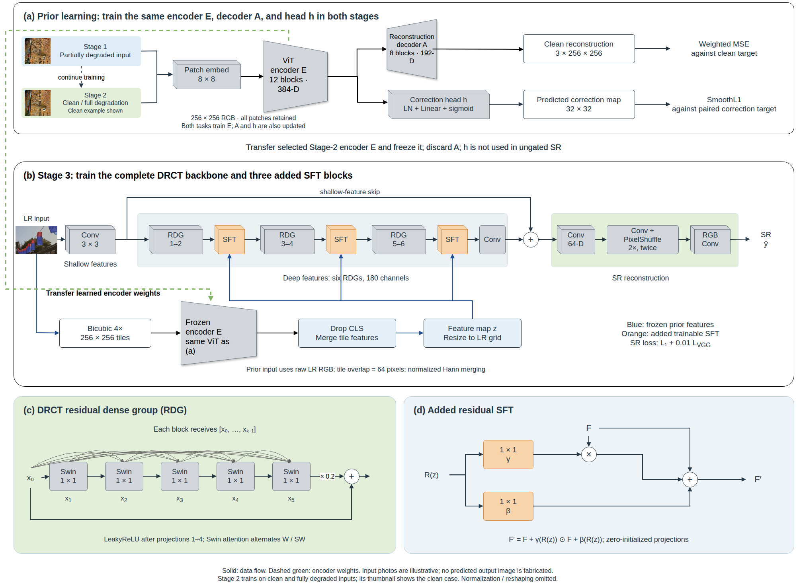

# CorrPrior

## Correction-Calibrated Spatial Priors for Real-World Image Super-Resolution

**Le Hoai Nam and Nguyen Hoang Ha**

University of Science and Technology of Hanoi

Research implementation for learning a spatial restoration prior from paired
degraded and clean images, then transferring its features to a super-resolution
network.

**Status:** private development repository during advisor review. The manuscript
is maintained separately. No publication acceptance, public checkpoint release,
or end-to-end reproduction in this extracted repository is claimed.

[Method](#method) · [Results](#results) · [Installation](#installation) ·
[Training](docs/reproduction.md) · [Evaluation](docs/evaluation.md) ·
[Reproducibility](docs/reproducibility.md) · [Figures](docs/figures.md)

## Method

CorrPrior learns two related tasks: reconstructing a clean image and predicting
how much each observed patch differs from its clean reference. The paired
differences provide continuous targets without manual degradation labels.
For SR, the trained encoder is frozen and its spatial features guide DRCT
through residual Spatial Feature Transform (SFT) blocks.



**Architecture.** The dashed green connection transfers learned encoder weights,
not training images. Stage 3 freezes that encoder and trains the complete DRCT
backbone and the added SFT blocks. The prior decoder and correction head are
not used in the main SR model. Input thumbnails are illustrative.
[Full-size figure](docs/assets/architecture.png) ·
[Editable draw.io source](docs/assets/architecture.drawio)

| Stage | Input | What is trained | Purpose |
| --- | --- | --- | --- |
| 1. Prior learning | Partially degraded images | ViT encoder, reconstruction decoder, correction head | Learn image content and local correction patterns |
| 2. Prior adaptation | Clean and fully degraded images | The same encoder, decoder and head | Adapt the prior to inputs closer to those used for SR |
| 3. Super-resolution | LR images | Full DRCT backbone and three SFT blocks | Learn how to use the frozen encoder features for reconstruction |

All input patches are retained in Stages 1 and 2. Stage 3 inserts SFT after
DRCT groups 2, 4 and 6. Zero initialization preserves the pretrained backbone's
initial output. The main inference model needs neither the prior decoder nor
the correction head: **it uses learned features, not correction-score gating**.
The code also retains the gated and random-prior controls and an exploratory
SwinIR integration.

## Results

Reported camera-balanced RealSR results for real-world 4x SR:

| Method | Prior | PSNR (dB) ↑ | SSIM ↑ | DISTS ↓ | LPIPS ↓ |
| --- | --- | ---: | ---: | ---: | ---: |
| DRCT-Base | None | 27.2828 | 0.7807 | 0.196085 | 0.301174 |
| DRCT-RandPrior | Frozen random encoder | 27.2985 | 0.7804 | 0.196111 | 0.302284 |
| **CorrPrior** | Frozen learned encoder | **27.4307** | **0.7831** | **0.195052** | 0.303456 |
| CorrPrior-Gated | Learned encoder and score gating | 27.4290 | 0.7828 | 0.195770 | 0.303573 |

All four variants share the downstream initialization, data order, seed, loss
and 100,000-update SR budget. The learned and random priors have the same
architecture. CorrPrior improves PSNR over DRCT-RandPrior by **0.1321 dB**
(paired 95% CI: **[0.0903, 0.1827]**, computed before rounding table entries).
The matched budget does not include the cost of prior pretraining.

The benefit is not uniform across settings: correction-score gating has no
supported additional PSNR gain; the matched SVSR PSNR difference is inconclusive;
perceptual metrics and exploratory SwinIR results are mixed. These are
single-seed results, and the confidence intervals describe test-sample
uncertainty. See [result scope](docs/results.md) for the exact comparisons and
remaining experiments.


**What the controls show.** Left: the learned prior improves RealSR PSNR over
the random-prior control; the gated and SVSR PSNR comparisons remain
inconclusive. Right: removing or shifting prior features reduces the fixed
CorrPrior checkpoint's PSNR. These intervention effects are not gains over
retrained baselines. Error bars show test-sample uncertainty, not variation
across training seeds. [Values and full comparisons](docs/results.md).

### Qualitative results


**RealSR examples.** CorrPrior is outlined in blue. Canon_043 and Nikon_033
are lower-median cases; Canon_011 and Nikon_039 are nearest the third quartile
of CorrPrior's full-image PSNR improvement over DRCT-RandPrior within each
camera subset. These are not maximum-gain examples. Differences within the
DRCT group are subtle; the crops illustrate reconstruction behavior rather
than establish universal visual superiority.
[Full-size comparison](docs/assets/qualitative_comparison.jpg).

## Installation

The portable validation environment uses Python 3.12 and PyTorch 2.5.1.
It is separate from the original GPU training environment. See
[environment notes](docs/reproducibility.md#environment) before training.

```bash
git clone https://github.com/namle24/CorrPrior.git
cd CorrPrior
python3 -m venv .venv
source .venv/bin/activate
python -m pip install --upgrade pip
# CPU validation. Choose a compatible GPU build separately for training.
python -m pip install torch==2.5.1 torchvision==0.20.1 --index-url https://download.pytorch.org/whl/cpu
python -m pip install -r requirements-dev.txt
python -m pytest -q
```

Use `python scripts/run.py <entrypoint.py> ...` for the retained training and
evaluation scripts. The launcher sets import paths and provides the legacy
torchvision import alias needed by BasicSR; it does not change model behavior.

## Data and checkpoints

Dataset collections, trained weights, raw outputs and per-image measurements
are **not included**. Only the selected illustrative thumbnails and comparison
crops shown above are packaged as documentation figures. Obtain datasets
through their original providers and comply with their terms. Checkpoint
release is pending author approval; there is currently
no public download link.

The main workflow requires aligned training crops, the selected prior checkpoint
and a shared pretrained DRCT checkpoint. Evaluation additionally requires the
final SR EMA checkpoint. Missing learned priors are rejected rather than silently
replaced by random weights. See [data layout](docs/data.md) and the
[stage-by-stage commands](docs/reproduction.md).

For example, after obtaining the required checkpoints and arranging the data:

```bash
python scripts/make_sr_config.py --mode test --variant corrprior \
  --prior-checkpoint checkpoints/prior_stage2.pth \
  --sr-checkpoint checkpoints/corrprior_ema_100k.pth \
  --dataset realsr --output runs/configs/corrprior_realsr.yml
python scripts/run.py DRCT/drct/test.py -opt runs/configs/corrprior_realsr.yml
```

## Repository layout

```text
PD_MAE_SR/          Prior architecture, paired data loaders, training and tests
DRCT/drct/         DRCT/SwinIR integration, SFT, SR training and inference
DRCT/options/      Experiment templates with portable paths
DRCT/scripts/      Metrics, paired statistics, diagnostics and protocol checks
tools/degradation/ Degradation implementation used by the prior-data generator
scripts/           Portable launcher, config creation and release checks
tests/             Additional extraction and configuration tests
docs/              Data, reproduction, evaluation, results and provenance
docs/assets/       Architecture, editable draw.io, result figures and plotted values
```

The historical `PD_MAE_SR` and `RN_PD_MAE` names are retained to preserve imports,
checkpoint keys and experiment traceability. The paper name is **CorrPrior**.
The source extraction is recorded in [provenance](docs/provenance.md).

## Citation and acknowledgements

Until publication metadata is available, cite this repository as software using
[CITATION.cff](CITATION.cff). No DOI or accepted-journal citation is assigned.

We build on [DRCT](https://github.com/ming053l/DRCT),
[BasicSR](https://github.com/XPixelGroup/BasicSR),
[MAE](https://github.com/facebookresearch/mae),
[timm](https://github.com/huggingface/pytorch-image-models) and
[SwinIR](https://github.com/JingyunLiang/SwinIR).
See [THIRD_PARTY_NOTICES.md](THIRD_PARTY_NOTICES.md) for attribution and licensing
scope. A project-wide release license has not yet been chosen; do not assume
that the DRCT MIT license covers every file in this repository.

For implementation questions, open an issue in this repository. Before making
it public, complete the [release checklist](docs/reproducibility.md#public-release-checklist).
