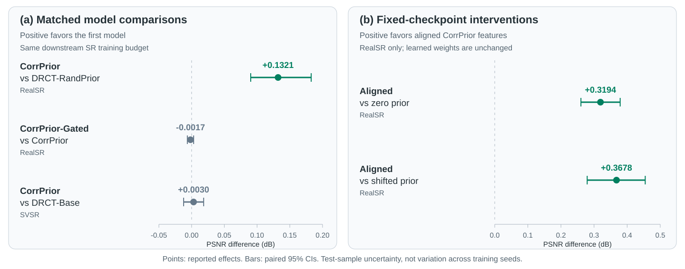
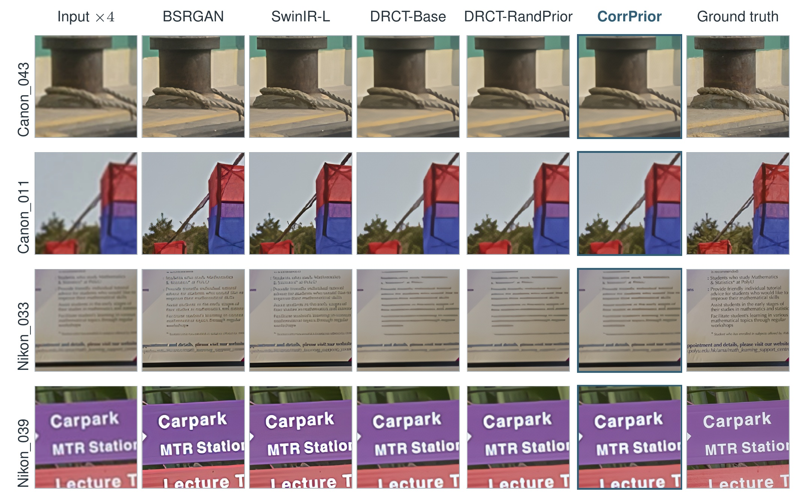

# Reported results and their scope

These values summarize the authors' existing experiments, not runs performed
during repository extraction. The manuscript is kept separately by request.
The snapshot identifier is recorded in `provenance.md`.

## Comparison with existing methods

The following results use a common evaluator and the same LR inputs. External
methods retain their own training histories; this is not a matched-training
comparison. PSNR/SSIM use luminance with a four-pixel border crop. RealSR
averages Canon and Nikon equally; SVSR averages 1,119 captures from 141 scenes.
Bold marks the best rounded value in each column, including ties.

### RealSR, 4x

| Method | PSNR (dB) ↑ | SSIM ↑ | LPIPS ↓ | DISTS ↓ |
| --- | ---: | ---: | ---: | ---: |
| BSRGAN | 26.5080 | 0.7750 | 0.2687 | 0.1759 |
| Real-ESRGAN | 25.8287 | 0.7733 | 0.2730 | 0.1688 |
| SwinIR-M | 26.0297 | 0.7807 | 0.2597 | 0.1610 |
| SwinIR-L | 26.4382 | 0.7869 | 0.2516 | **0.1545** |
| SRFormer-S | 25.7279 | 0.7768 | **0.2495** | 0.1601 |
| E2-RealSR | 26.4169 | 0.7821 | 0.2862 | 0.1889 |
| DAA-IMDN | **27.8407** | **0.8030** | 0.3484 | 0.2020 |
| AdcSR | 25.6082 | 0.7326 | 0.2989 | 0.1864 |
| DRCT-Base | 27.2828 | 0.7807 | 0.3012 | 0.1961 |
| **CorrPrior** | 27.4307 | 0.7831 | 0.3035 | 0.1951 |

CorrPrior ranks second in PSNR among these methods. It has lower LPIPS and
DISTS than DAA-IMDN, which has higher PSNR/SSIM. Other methods obtain better
perceptual scores; no method is best on all four metrics.

### SVSR, 4x

| Method | PSNR (dB) ↑ | SSIM ↑ | LPIPS ↓ | DISTS ↓ |
| --- | ---: | ---: | ---: | ---: |
| BSRGAN | 26.8788 | 0.8234 | 0.2927 | 0.1886 |
| Real-ESRGAN | 26.0319 | 0.8087 | 0.2996 | 0.1813 |
| SwinIR-M | 26.4013 | 0.8200 | 0.2953 | 0.1789 |
| SwinIR-L | 26.6967 | 0.8250 | **0.2800** | **0.1715** |
| SRFormer-S | 25.7614 | 0.8036 | 0.2829 | 0.1743 |
| E2-RealSR | 27.2979 | 0.8037 | 0.3553 | 0.2292 |
| DAA-IMDN | 27.4485 | 0.8089 | 0.4538 | 0.2436 |
| AdcSR | 25.4297 | 0.7488 | 0.3439 | 0.2004 |
| DRCT-Base | 27.5431 | **0.8302** | 0.3033 | 0.2165 |
| **CorrPrior** | **27.5461** | **0.8302** | 0.3031 | 0.2141 |

CorrPrior has the highest mean PSNR in this group, but its matched PSNR
difference from DRCT-Base is not statistically resolved. The DISTS reduction
is a secondary benefit, as quantified below. AdcSR is a one-step generative
method, not a fidelity-trained counterpart.

## Controlled comparisons

The plot keeps trained-model comparisons and post-hoc interventions separate.
Both use PSNR differences, but answer different questions. Positive values
favor the first model or the original aligned features. The dashed line marks
zero effect. RealSR intervals account for cameras; SVSR intervals account for
scene groups. The two panels use different x-axis ranges for readability.
[Plotted values](assets/psnr_effects.csv) and
[figure provenance](figures.md) are included.

| Comparison | Dataset / endpoint | Candidate minus control | Paired 95% CI | Interpretation |
| --- | --- | ---: | --- | --- |
| CorrPrior vs DRCT-RandPrior | Camera-balanced RealSR PSNR | +0.1321 dB | [0.0903, 0.1827] | Supports learned information beyond an equally sized random branch |
| CorrPrior-Gated vs CorrPrior | Camera-balanced RealSR PSNR | -0.0017 dB | [-0.0065, 0.0031] | No supported additional gain from score gating; not an equivalence result |
| CorrPrior vs DRCT-Base | Scene-clustered SVSR PSNR | +0.0030 dB | [-0.0122, 0.0184] | Inconclusive PSNR gain |
| CorrPrior vs DRCT-Base | Scene-clustered SVSR DISTS | -0.002322 | [-0.002834, -0.001797] | Secondary metric benefit, not a replacement for the PSNR endpoint |

On RealSR, absolute PSNR is 27.4307 dB for CorrPrior, 27.2985 for
DRCT-RandPrior, 27.2828 for DRCT-Base and 27.4290 for CorrPrior-Gated.
Effect sizes use unrounded per-image measurements, so subtracting rounded
table cells can give a slightly different final digit.

## Mechanism diagnostics

The selected Stage 2 head predicts a mean correction of 0.0038 on clean inputs.
Within-image correlations with correction targets range from 0.6940 to 0.7813
across degraded inputs. On 300 unseen spatial mixtures, aligned predictions
correlate more strongly with targets than spatially shifted predictions.

Post-hoc interventions on the fixed CorrPrior SR checkpoint reduce RealSR PSNR
by 0.3194 dB when features are zeroed and 0.3678 dB when features are shifted.
These are intervention effects on one trained model, not gains over retrained
baselines or independent confirmation of the primary result.

## Qualitative comparison

Rows show Canon_043, Canon_011, Nikon_033 and Nikon_039. Within each camera,
the first example is the lower-median case and the second is nearest the third
quartile of CorrPrior-minus-DRCT-RandPrior full-image PSNR. Selection does not
use the maximum improvement or crop-level PSNR. BSRGAN and SwinIR-L show
sharper contours, while DRCT variants are smoother and differ subtly from one
another. These examples illustrate the fidelity/perception trade-off; the
statistical claims use complete test sets.

## Cost and limitations

The DRCT integration adds 415,800 trainable SFT parameters and 22,178,232 total
parameters including the frozen prior. Freezing the encoder does not remove
its inference cost. Perceptual metrics do not uniformly favor CorrPrior, and
no human preference study was conducted.

The principal DRCT comparisons use one seed at 4x scale. The study does not
isolate the effect of Stage 2, each prior-learning loss or the fixed correction
mapping parameter. Exploratory SwinIR transfer is mixed and has no matched
random-prior control. Do not infer backbone-independent improvement.

## Historical experiment identifiers

| Identifier | Paper name | Role |
| --- | --- | --- |
| B0 | DRCT-Base | No prior branch |
| C0 | DRCT-RandPrior | Frozen random encoder, matched branch capacity |
| C2 | CorrPrior | Main ungated learned-prior model |
| P0 | CorrPrior-Gated | Direct correction-score gating control |

The initial gated study did not meet its DISTS criterion. The fidelity follow-up
and later ungated analysis must not be presented as if all endpoints and model
choices were part of a single prospective experiment. Selection rules and
exploratory limits are described in the manuscript. Historical analysis utilities
are retained for traceability; their presence does not mean all conditional
experiments were executed.
